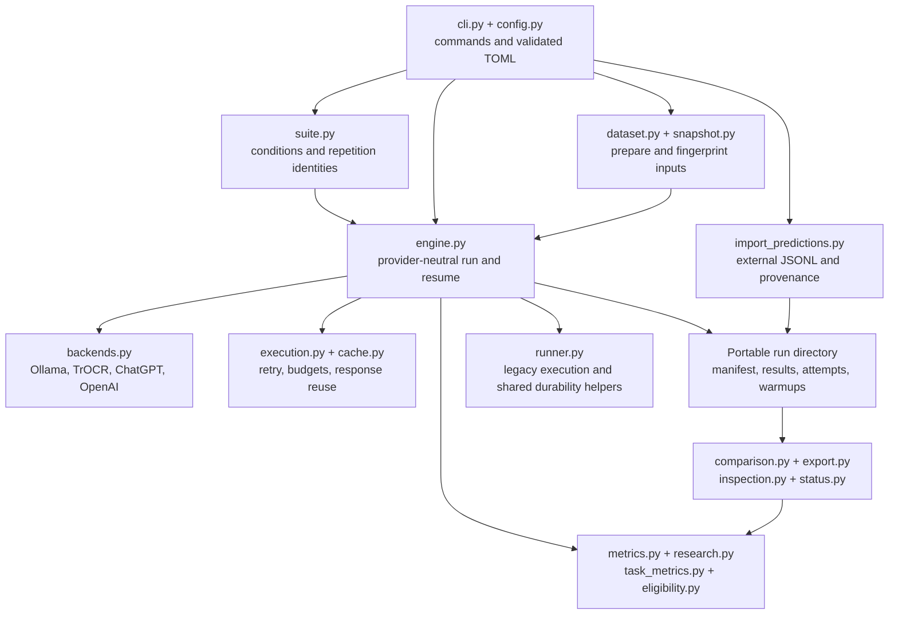
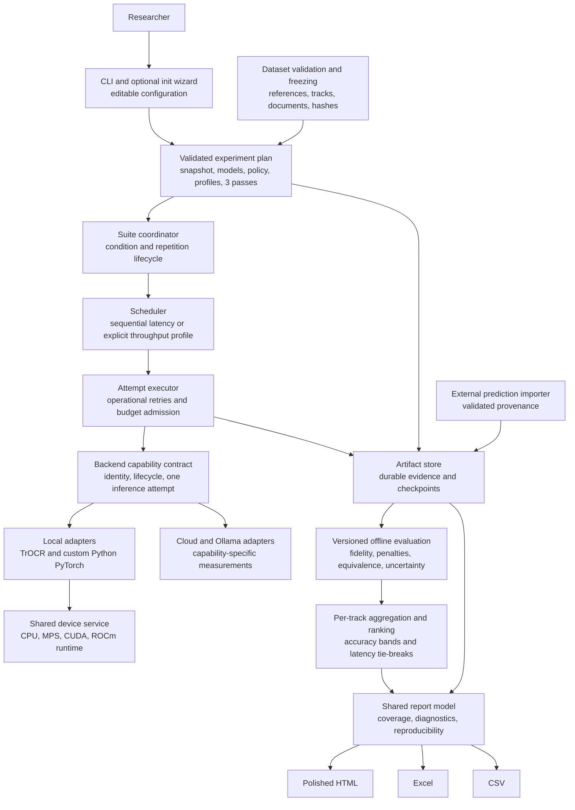
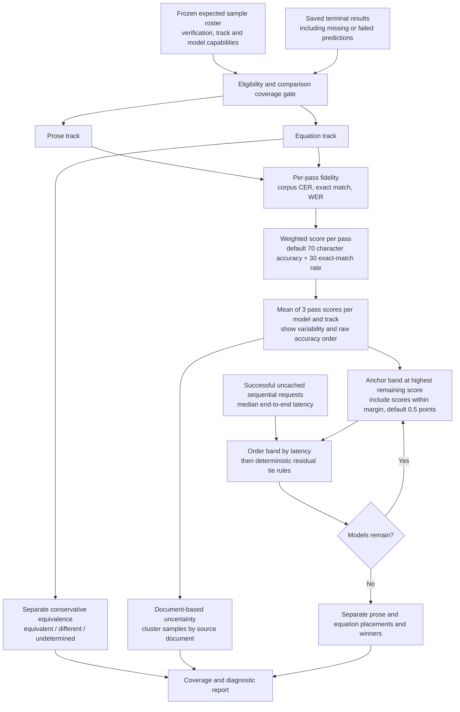
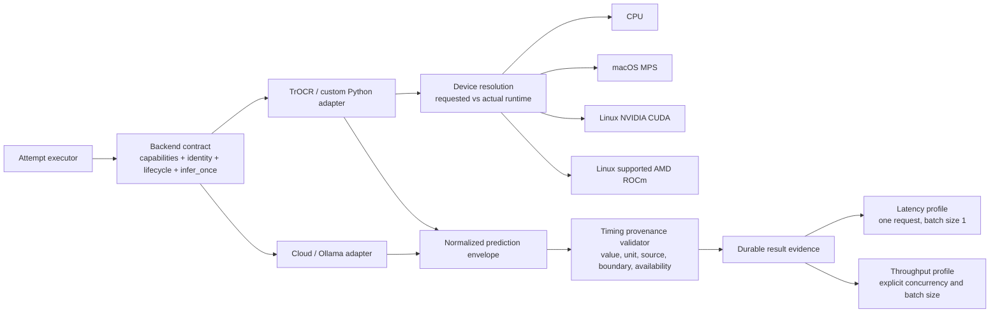
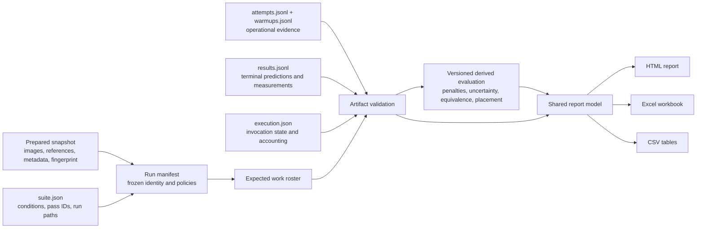
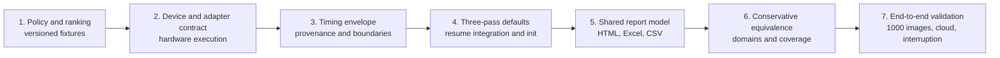

# CLI VLM Benchmarker architecture

Implementation guide for coding agents, based on [PRODUCT_SPEC.md](PRODUCT_SPEC.md)
and the source tree inspected on 2026-10-28. The product specification controls
product scope; this document proposes engineering contracts and module boundaries.
Read [IMPLEMENTATION_STATUS.md](IMPLEMENTATION_STATUS.md) for prior verification
claims. Diagrams use Mermaid and can be edited as text.

**Status notation:** `existing` means code is present, not that live providers or
hardware have been validated. `target` means proposed work. All diagrams after
the first describe the target design. Proposed Python module and field names are
design suggestions, not available APIs or commands.

## 1. Existing implementation: extend these seams



`engine.py` is the main provider-neutral execution seam. It currently also owns
much scheduling, timing, persistence, and scoring work. Extract responsibilities
incrementally while preserving its public entry points and resume checks.
`runner.py` contains both older execution and durability helpers imported by the
engine; do not remove it as an apparently unused alternate runner.

Existing summary code ranks complete runs by corpus CER. It does **not** implement
the new weighted score and practical-margin ranking. Existing equation metrics
and optional rendered similarity do **not** establish mathematical equivalence.
Existing HTML inspection is a useful starting point, not the full product report.

## 2. Target component boundaries



| Boundary | Ownership and dependency rule | Existing seam → proposed addition |
|---|---|---|
| Configuration | Validate once; freeze effective values before requests. Wizard only writes normal editable config. | `config.py`, `cli.py` → optional `init.py` |
| Scheduling | Enumerate expected work, passes, and profiles; never inspect reference agreement to choose attempts. | `suite.py`, `engine.py` → `scheduling.py` |
| Attempt execution | Own admission, retries, cache policy, and attempt evidence; adapter makes one request. | `engine.py`, `execution.py`, `cache.py` |
| Artifact store | Single writer per run, durable append, atomic metadata, validation and recovery. No model calls. | `runner.py`, `snapshot.py` → `artifacts.py` |
| Backend | Advertise capabilities; load, preprocess, infer, convert output, close. No scoring or nested managed retries. | `backends.py` → `adapters.py` contract plus backend implementations |
| Device | Resolve requested hardware, synchronize timings, record identity and memory. | TrOCR device code → `devices.py` |
| Evaluation | Consume frozen inputs and predictions; never invoke inference. | `metrics.py`, `research.py`, `task_metrics.py` → `scoring_policy.py`, `equivalence.py` |
| Ranking | Pure deterministic function over compatible track aggregates and timing eligibility. | `comparison.py`, `suite.py` → `ranking.py` |
| Reporting | Render one report model without credentials, provider setup, or model loading. | `export.py`, `inspection.py` → `report_model.py`, HTML renderer |

Use one Python process with bounded local scheduling and portable files. The
approximately 1,000-image target does not justify distributed workers or a required
database. Generic hosted custom-model endpoints, Windows validation, slide
generation, and standalone chart exports remain outside initial scope.

## 3. Execution, retries, and interruption recovery

```mermaid
sequenceDiagram
    actor User
    participant CLI
    participant Suite
    participant Store as Artifact store
    participant Exec as Attempt executor
    participant Backend
    participant Eval as Offline evaluator
    User->>CLI: Run validated experiment
    CLI->>Suite: Frozen plan and prepared snapshot
    Suite->>Store: Persist condition/repetition identity and run path
    Suite->>Store: Lock run; validate or create manifest
    loop Each pass, model, and eligible sample
        Suite->>Store: Check committed terminal result
        alt Already committed
            Store-->>Suite: Reuse evidence; do not remeasure
        else Pending
            Suite->>Exec: Execute work key with frozen controls
            Exec->>Exec: Check request/spend admission
            alt Budget exhausted or provider paused
                Exec->>Store: Save resumable stop and accounting
            else Admitted
                Exec->>Store: Persist attempt start
                Exec->>Backend: One attempt, image and prompt only
                Backend-->>Exec: Prediction, timings, usage OR classified error
                Exec->>Store: Persist attempt finish
                opt Retryable operational failure and remaining allowance
                    Exec->>Exec: Honor bounded retry delay; recheck budget
                    Note over Exec,Backend: Repeat attempt protocol; never retry based on correctness
                end
                Exec->>Store: Commit one terminal result after success or exhausted failure
            end
        end
    end
    Suite->>Store: Persist final or interrupted status
    Store->>Eval: Frozen evidence, including expected missing results
    Eval-->>CLI: Derived scores, rankings, and report model
```

This sequence is schematic: a resumable stop exits scheduling rather than
continuing to every pending sample. Warmups have separate attempt records, count
toward operational budgets, and are excluded from ranking measurements.

Proposed work key: `(run_id, model_identity, sample_id)`; the run identifies its
condition and repetition. Never collapse three passes into the same model/sample
row. Keep attempt number separate from repetition number.

On resume, acquire the run lock and validate manifest integrity, snapshot/image
hashes, model revision, policy version, prompts, and measurement controls. Reject
identity changes; start a new run instead. Preserve completed rows, repair only a
provably interrupted final JSONL append, and reject duplicate/unknown keys or
interior corruption. Budget overrides remain invocation metadata, not rewritten
benchmark identity.

A crash after a provider response but before a durable result may cause a request
to be repeated. Local checkpoints cannot promise exactly-once remote execution.
Retain unmatched attempt starts as uncertain attempts and make usage uncertainty
visible. Imported runs have no inference-resume path; reimport into a new run.
Previously committed operational failures may be explicitly retried with attempt
history retained; valid wrong transcriptions must never be selected for retry.

## 4. Scoring and ranking pipeline



For each model, track, and pass, use the same frozen eligible roster:

```text
CER = sum(character_edits) / sum(reference_characters)
EM  = exact_matches / eligible_sample_count
score = 100 * (w_char * max(0, 1 - CER) + w_exact * EM)
defaults: w_char = 0.70, w_exact = 0.30; weights sum to 1
final_accuracy = arithmetic_mean(per_pass_scores)
```

Normalize prediction/reference under a frozen versioned policy. Reject empty
references under that policy. Missing and failed predictions contribute all
reference-character deletions and zero exact matches. Preserve raw CER above 1;
clamp only composite character accuracy. WER is diagnostic. Treat unsupported
tasks as declared eligibility exclusions, never as successful empty outputs.
Models using different eligible rosters must not silently share a leaderboard.

Proposed ranking details to freeze before measurement:

- Form inclusive accuracy bands from the highest remaining score, without rounding
  displayed scores first. This avoids non-transitive pairwise margin comparisons.
- Pool successful, measured, uncached request latencies across passes for the
  median; do not average pass medians. Show pass-level distributions as well.
- Within a band, order by median latency ascending, then score descending, then
  canonical model identity ascending. For missing comparable latency, display
  accuracy but withhold speed-resolved placement/winner claims for the affected
  band. Do not treat absent latency as zero.
- Completed passes with operational failures are scored with penalties. An
  interrupted experiment may show provisional penalty-inclusive scores, but has
  no final winner until every planned pass reaches a terminal state. Imported
  partial coverage is explicitly labeled and cannot silently become complete.
- Resample source documents jointly across compared models; preserve pass
  structure and do not count repetitions as independent documents. Freeze the
  interval method, seed, replicate count, and handling of missing document IDs.
  If document metadata is unavailable, label document-based uncertainty unavailable.
  Uncertainty does not alter practical accuracy bands.

Example with a 0.5-point margin: A=95.0/200ms, B=94.6/100ms,
C=94.2/50ms. First band contains A and B, placing B then A. C forms the next band
despite being within 0.5 points of B. Prose and equations repeat this independently.

Equivalence receives only equation pairs plus explicit domains/assumptions.
Unsupported notation, parsing failure, timeout, or inconclusive proof yields
`undetermined`. `different` requires a justified result within the stated domain.
Report counts, applicable/attempted sample counts, and determinate coverage;
equivalence and visual rendering similarity never feed the primary fidelity score.

## 5. Backend, device, and measurement contracts



| Proposed contract | Required information |
|---|---|
| Capabilities | Supported tracks/sample types, batching, streaming, concurrency safety, available timing hooks and usage fields |
| Identity | Provider, model/checkpoint revision or hash, adapter version, effective generation controls |
| Local runtime | OS, hardware, requested/actual device, precision, PyTorch/runtime/driver versions where available, warmup and fallback policy |
| One-attempt input | Image, track, prompt and effective controls; reference text is not passed to adapters |
| One-attempt output | Prediction text, actual identity, usage and source, timing observations, optional diagnostics |
| Failure | Operational classification, retryability, provider delay, sanitized error; no secrets |
| Timing observation | Metric name, value or null, unit, provenance, start/end boundaries, unavailability reason |

Custom Python adapters own loading, preprocessing, inference, output conversion,
and optional instrumentation. Device services own accelerator resolution and
synchronization around measured local work. For asynchronous accelerators,
synchronize before the start and after completion. Record preprocessing, image
encoding, model load/cold start, and warmup separately with explicit boundaries;
do not assume their durations are disjoint or sum them blindly.

Explicit GPU selection must fail clearly if unsupported; `auto` may select CPU
under a documented, recorded policy. ROCm uses PyTorch's CUDA-facing device API;
detect and record the HIP/ROCm runtime separately from NVIDIA CUDA. The current
TrOCR config accepts only `auto`, `cpu`, and `mps`; the wider matrix is target work,
requiring validation on actual hardware.

Ranking end-to-end latency is client wall time around one adapter request,
including preprocessing/encoding and transport within that boundary. Use only
successful measured attempts for the median. Report retry-inclusive completion
time and failure/retry rate separately. Show p50/tail latency and throughput with
the exact timing denominator. Throughput experiments use elapsed workload wall
time, not a sum of overlapping request durations.

Time to first output is not pure prefill. Provider-reported and instrumented
timings retain their source; unavailable cloud internals stay null. Tokens/second
must carry tokenizer and token-count provenance. Cached results may contribute
clearly labeled accuracy evidence, but never measured speed; latency, repeated,
and stochastic measurement runs bypass response caching. Resuming a committed
result is checkpoint reuse, not a new timing observation.

## 6. Portable artifacts and offline reports



The filenames above already exist; the policy and normalized measurement fields
are additions. Preserve portable input copies and existing schema-v2 readers.
Define explicit version dispatch for new evaluation/measurement schemas; never
reinterpret legacy scoring version `1` as the new weighted policy. Unknown
required versions fail with an actionable compatibility error. Legacy runs retain
their original metrics; optional new-policy rescoring produces separately
identified derived artifacts instead of silently changing historical rankings.

Freeze scoring weights, normalization, failure rules, margin, aggregation, tie
rules, expected pass count, measurement profile, environment, and model controls.
Keep inference identity separate from derived evaluation identity: changing an
offline scorer creates a new evaluation ID linked to the same raw evidence.
Do not rewrite provider output to encode a missing-prediction penalty; synthesize
that contribution from the expected roster at evaluation time.

The report model must include both tracks, formulas and policy versions, raw
accuracy order and final placement, coverage/exclusions, per-pass variability,
document uncertainty, available timing breakdowns, hardware/provider context,
equivalence outcomes, usage/cost provenance, and difficult examples with images,
references, predictions, and edit details. Cost can be known, estimated, or
unknown; unknown is never displayed as free. HTML must escape untrusted text and
use portable image references. Renderers consume saved artifacts without any new
inference. Excel and CSV values must derive from the same report fields as HTML.

## 7. Implementation order and acceptance evidence



| Slice | Agent acceptance evidence |
|---|---|
| Policy | Hand-calculated weighted examples; unequal reference lengths; CER above 100%; missing/failed predictions; empty references; independent track winners; anchored-band edge cases and stable ties |
| Devices/adapters | Capability rejection before inference; custom adapter lifecycle; no reference leakage; explicit GPU failure; actual CPU/MPS/CUDA/ROCm execution for each claimed configuration |
| Measurement | Correct synchronization boundaries, timing-source labels, unavailable fields, cache exclusion, retries, warmup exclusion, and distinct sequential/throughput calculations |
| Orchestration | Default three complete passes with unique IDs; interruption during append and after remote response; resume preserves identity and committed rows; budgets stop new scheduling; wizard round-trips through config validation |
| Reports | Same values in HTML/Excel/CSV; offline regeneration; legacy version handling; missing timing/cost; mixed provider context; escaped difficult examples; inspect rendered HTML and workbook layout |
| Equivalence | Proven equivalent and different cases under explicit domains; parser failures, unsupported notation, and inconclusive checks remain undetermined |
| Release | Measured approximately 1,000-image workflow; live cloud smoke tests; recovery and artifact portability; published hardware/runtime matrix and observed limits |

Before each slice, inspect its existing tests and preserve relevant contracts.
Add behavior-focused fixtures and run the affected tests plus repository lint and
format checks; run the full suite for integrated behavior changes. Mocked provider
tests and device detection alone are not live-provider or GPU support evidence.
The existing status document's 370-test result is historical, not validation of
this target architecture.
